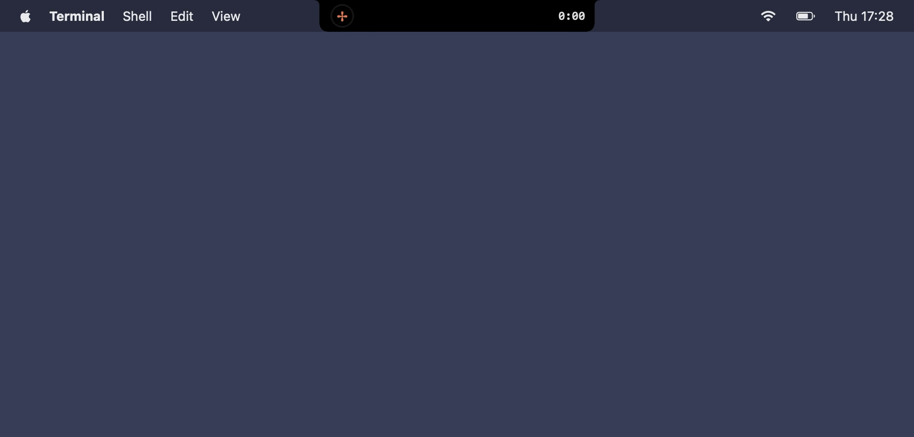
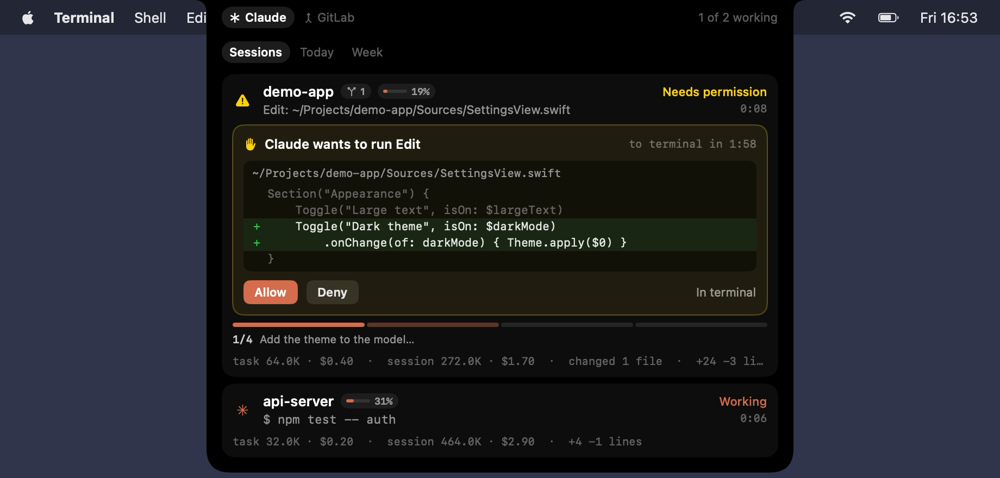
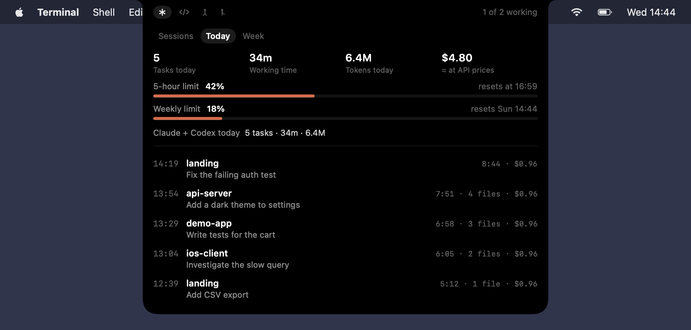
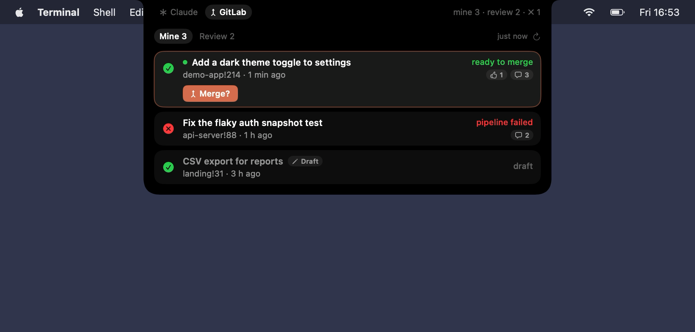
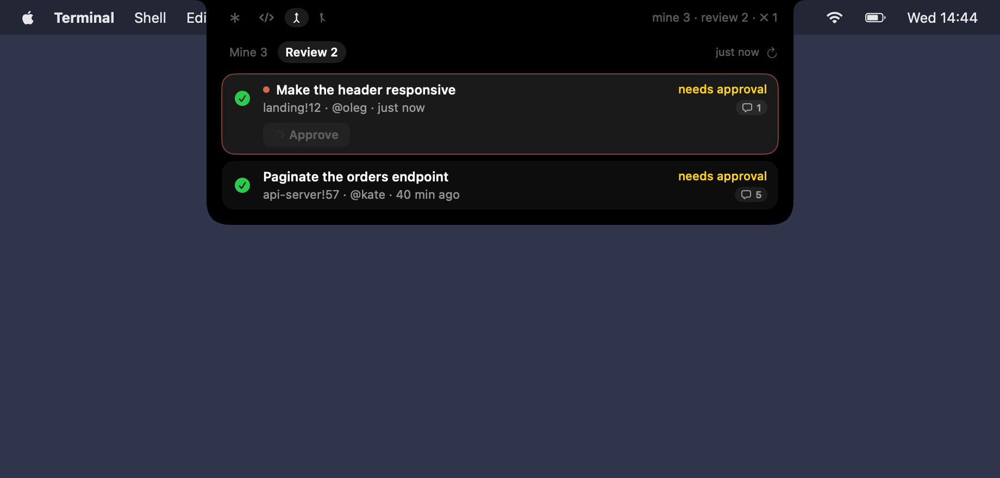

# Peppap

Your dev status in the MacBook notch: Claude Code and Codex sessions, GitLab merge requests, GitHub pull requests and more.



<sub>Full video: [docs/demo.mp4](docs/demo.mp4). The demo uses made-up projects and data.</sub>

<table>
  <tr>
    <td></td>
    <td></td>
  </tr>
  <tr>
    <td></td>
    <td></td>
  </tr>
</table>

## Features

The expanded notch has a source switch next to the notch (Claude · Codex · GitLab · GitHub) and the source's tabs below it. Each source shows up once it is connected: Claude and Codex after you connect their hooks, GitLab and GitHub after you enter a token.

### Claude Code

- **Status in the notch.** While Claude works, a ✻ spinner turns next to the notch, a ring shows progress through Claude's plan, and a timer counts the current task.
- **Answer permission requests from the notch:** Allow, Always allow, Deny, or hand the request back to the terminal. If the session's terminal is already in front, the request goes straight there. If you don't answer, it returns to the terminal after a configurable timeout.
- **Change preview** (Edit / MultiEdit / Write) right in the permission card.
- **Claude's questions** (AskUserQuestion) with answer options in the notch.
- **Per-session details:** Claude's plan (`TodoWrite`, `TaskCreate`) with progress, context usage, running subagents, Claude's last reply, tokens and cost for the task and the session, changed files and lines.
- **Exact subscription limits** (5-hour and weekly) and exact context usage, taken from the Claude Code status line. If you already had a status line, it keeps showing: Peppap only reads the data.
- **Today tab:** daily totals, usage limits and a timeline of finished tasks.
- **Week tab:** a 7-day chart by cost, time or number of tasks, plus a Markdown export of the weekly report.
- **Quick replies:** "Continue", "Run the tests" or your own message. Works with Terminal and iTerm2.
- **Jump to a session:** the right Terminal or iTerm2 tab (matched by tty), the project window in VS Code, Cursor, Windsurf or Zed, or just the terminal app.
- **Resilience:** closed terminals disappear from the list, Esc interrupts are detected from the transcript, and live sessions are restored after Peppap restarts.
- **Right-click a session** to pin it, rename it, or hide it until its next activity.

### Codex

- The same **Sessions, Today and Week** tabs as for Claude: status in the notch, the plan (`update_plan`), subagents, Codex's last reply, tokens, changed files.
- **Answer permission requests from the notch:** Allow, Deny or hand the request back to the terminal, with a preview of `apply_patch` edits. Codex has no "Always allow" for hooks.
- **Exact subscription limits** (5-hour and weekly) and context usage, read from Codex session logs in `~/.codex/sessions`. Cost isn't estimated: the logs have tokens but no prices.
- Quick replies, jumping to the session's terminal and Esc interrupts work as for Claude.

### GitLab

- **Mine and Review tabs:** your open merge requests and the ones waiting for your review, with pipeline status, approvals, comments and what blocks the merge.
- **Act without the browser:** approve or revoke, merge (or merge when the pipeline succeeds), retry a failed pipeline, rebase, mark as ready or draft. Buttons appear on the row you hover or select; merge asks for a second click. Only the actions GitLab allows you are shown.
- **Notifications** when someone requests your review, a pipeline fails in your MR, or your MR becomes ready to merge. While Claude is idle, the collapsed notch shows a merge icon with the number of new events.
- Works with self-hosted GitLab (CE or EE). The token is kept in the Keychain: `read_api` is enough to look, `api` also enables the actions.

### GitHub

- The same **Mine and Review** tabs for pull requests: yours and the ones where you or your team are asked to review, with check status, approvals, comments and what blocks the merge.
- **Actions:** approve, merge with the repository's default method (or enable auto-merge while checks run), re-run failed GitHub Actions jobs, rebase on the base branch, mark as ready or draft. GitHub doesn't let you revoke your own approval, so there is no Revoke.
- **Notifications** for review requests, failed checks and PRs that became ready to merge, as with GitLab.
- Works with github.com and GitHub Enterprise Server. The token is kept in the Keychain.

### Everywhere

- **Hotkey** (⌃⌥C by default) opens the notch with keyboard control: ←→ switch source, Tab switch tabs, ↑↓ select, ⏎ open, A/S/D/T answer a permission request; for a merge request A approve, M merge, P retry pipeline, B rebase, D ready/draft, R refresh; Esc close.
- **Notifications:** sound, trackpad haptics and auto-expanding notch. Sound can be limited to long tasks. Peppap stays quiet during calls (microphone in use) and in full-screen apps.
- **English and Russian interface**, following the system language or switched in Settings without a restart.
- **Settings window** (✦ menu → Settings…).

## Installation

Download `Peppap-<version>.dmg` from [Releases](../../releases) and drag Peppap to Applications. Peppap updates itself after that (✦ menu → Update…).

The app is not notarized by Apple, so macOS blocks a downloaded copy on first launch (in-app updates handle this for you). Remove the quarantine flag:

```sh
xattr -dr com.apple.quarantine /Applications/Peppap.app
```

Or open System Settings → Privacy & Security and click "Open Anyway".

Requires macOS 14 or later, Apple Silicon or Intel.

## Setup

### Claude Code

1. Hover over the notch and click **Connect**, or use the ✦ menu in the menu bar.
   Peppap adds its hooks and status line to `~/.claude/settings.json`. A backup is saved as `settings.json.peppap-backup`, and the scripts live in `~/.peppap/`.
2. Restart running `claude` sessions if they don't pick up the change.

The hook sends event JSON to `127.0.0.1:47821`. If Peppap isn't running, `curl` exits silently and Claude Code is unaffected.

### Codex

1. Connect the Codex hooks in the ✦ menu, Settings → Codex or the welcome window. Peppap adds them to `~/.codex/hooks.json` (backup: `hooks.json.peppap-backup`).
2. Codex runs new hooks only after you review them: run `/hooks` in Codex once and trust the Peppap hooks. Restart running `codex` sessions.

Events go to `127.0.0.1:47821/event/codex`; as with Claude, Codex is unaffected if Peppap isn't running.

The ✦ menu also has: sound toggle, settings, weekly report export (per agent), demo, demo recording, and disconnecting the hooks (for Claude, this restores your previous status line).

### GitLab

1. Create a personal access token with the `api` scope, or `read_api` if you only want to look (Settings → GitLab → **Create…** opens the right page).
2. Enter your GitLab host (e.g. `https://gitlab.example.com`) and the token in Settings → GitLab. The token is stored in the Keychain.
3. **GitLab** appears next to **Claude** in the expanded notch. The lists refresh every 2 minutes (configurable) and when you open them; press R to refresh, ⏎ or click to open an MR. Choose which events notify you in the same Settings section.

### GitHub

1. Create a token (Settings → GitHub → **Create…** opens the page): a classic token with the `repo` scope, or a fine-grained one with read and write access to Pull requests, Contents and Actions in the repositories you need.
2. Enter it in Settings → GitHub. The host is `https://github.com`; change it for GitHub Enterprise Server.
3. **GitHub** appears in the source switch, with the same tabs, keys and notification settings as GitLab.

## Building from source

```sh
./build.sh                         # for the current CPU
ARCHS="arm64 x86_64" ./build.sh    # universal build, as in CI
scripts/package.sh                 # dist/Peppap-<version>.zip and .dmg
open build/Peppap.app
```

Only the Command Line Tools are needed (Xcode is optional). Run the tests with `scripts/test.sh`.

Run `scripts/setup-signing.sh` once. It creates a local signing certificate in a separate keychain, so macOS permissions (such as controlling the terminal) survive rebuilds.

Peppap records its own README demo with made-up sessions and merge requests: ✦ menu → Record demo video…. This needs the Screen Recording permission. To record in English regardless of the interface language, run `curl "http://127.0.0.1:47821/demo-record?lang=en"` instead. Then build the GIF, the MP4 and the screenshots from the recording:

```sh
. scripts/lib.sh && swiftc -sdk "$(pick_sdk)" scripts/make-demo-media.swift -o /tmp/make-demo-media
/tmp/make-demo-media ~/Movies/Peppap/peppap-demo.mov docs 3 52 1840 10 \
  permission@10 today@32 gitlab-review@50 gitlab-mine@54
```

## Contributing and releases

Branches, commit messages and the release process are described in [CONTRIBUTING.md](CONTRIBUTING.md).
In short: `main` is protected, changes go through squash-merged pull requests with [Conventional Commits](https://www.conventionalcommits.org) titles, and `bun run release` cuts a version.

## How it works

Sources live in `Sources/Peppap/`, grouped by area:

| Folder | Purpose |
|---|---|
| `App/` | entry point, app delegate, menu bar menu (`StatusMenu`), debug commands of the local server, defaults (`Prefs`), English and Russian strings (`L10n`), global hotkey |
| `Agent/` | `Agent` (Claude Code or Codex) and `Agents` with the session stores of both |
| `Sessions/` | agent sessions, shared by Claude and Codex: hook and status line scripts (`HookInstaller`), local HTTP server for hook events (`EventServer`), hook event parsing, session state and permissions (`SessionStore`, one per agent), running processes and transcripts, tokens and cost (`AgentMonitor`, `UsageScanner`), change preview, task history and weekly report |
| `Codex/` | Codex specifics: `~/.codex/hooks.json` (`CodexHookInstaller`) and session logs: tokens, limits, the last turn (`CodexLog`) |
| `Forge/` | what GitLab and GitHub share: the merge request model and actions, change events, `MergeRequestStore` on top of a `MergeRequestSource` (`ForgeServer` from the settings or demo data), `Forges` with both stores |
| `GitLab/`, `GitHub/` | API clients and GraphQL parsers; GitHub states are mapped to the GitLab merge statuses the model uses |
| `Notch/` | the notch panel (`NotchController`: hover, auto-expand, keyboard) and its SwiftUI interface: `Sessions/`, `Stats/` (today and week), `MergeRequests/`, shared `Components/` |
| `Windows/` | settings, welcome and update windows |
| `System/` | Keychain, do-not-disturb (calls, full screen), jumping to a terminal or editor, self-update |
| `Demo/` | demo recording for the README: a scripted run on its own in-memory stores |
| `Support/` | formatting and string helpers |

Tests are in `Tests/`, one file per area. `scripts/make-icon.swift` generates the app icon.

## License

[MIT](LICENSE) © 2026 Alexander Buzmakov
